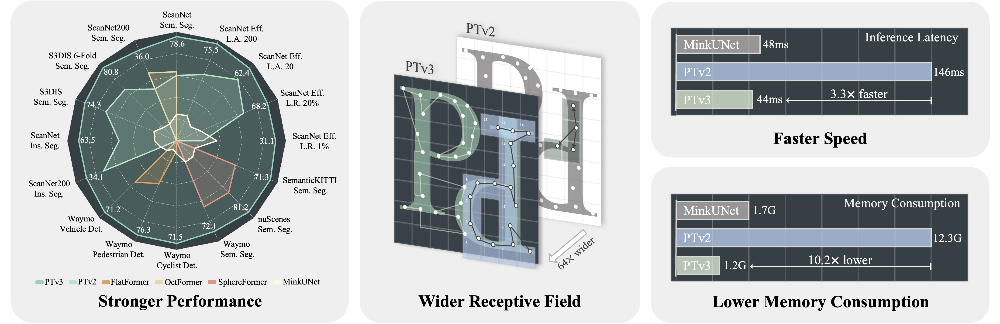

# Point Transformer V3

> 本文件为 [README.md](README.md) 的中文翻译；如有出入，以英文原版为准。

本仓库是论文 **_Point Transformer V3: Simpler, Faster, Stronger_** 的官方项目仓库，主要用于发布进度、更新说明、分享实验记录（含模型权重）以及处理 issue。代码将在 _[Pointcept](https://github.com/Pointcept/Pointcept) v1.5_ 中更新。  
[ Backbone ] [PTv3] - [ [arXiv](https://arxiv.org/abs/2312.10035) ] [ [Bib](https://xywu.me/research/ptv3/bib.txt) ] [ [Code](https://github.com/Pointcept/Pointcept) ]

<div align='left'>

</div>

## Sonata：自监督预训练的 PTv3
🚀 欢迎了解我们最新强大的自监督预训练 PTv3 —— [Sonata](https://github.com/facebookresearch/sonata)，其中包含多个使用我们预训练 PTv3 的可视化演示。

<div align='left'>

</div>

## 动态
- *2024 年 4 月 5 日*：PTv3 入选 CVPR'24 的 90 篇 **Oral** 报告之一（录用率 3.3%，仅占全部投稿的 0.78%）！
- *2024 年 2 月 28 日*：PTv3 被 CVPR'24 接收 🎉🎉🎉。
- *2023 年 12 月 31 日*：我们发布了 PTv3 的模型代码，从零训练的 ScanNet 与 ScanNet200 实验记录现已开放，更多内容即将推出。
- *2023 年 12 月 19 日*：我们发布了 PTv3 的项目仓库，如果对我们的工作有任何疑问，欢迎随时提 issue。填写[表单](https://forms.gle/jHoBNqfhqK94WG678)即可订阅更新，随时可通过编辑表单取消订阅。


## 目录
- [引用](#引用)
- [安装](#安装)
- [数据准备](#数据准备)
- [快速开始](#快速开始)
- [模型库](#模型库)

## 引用
如果 _PTv3_ 对你的研究有帮助，请引用我们的工作作为支持。(੭ˊ꒳​ˋ)੭✧
```bib
@inproceedings{wu2024ptv3,
    title={Point Transformer V3: Simpler, Faster, Stronger},
    author={Wu, Xiaoyang and Jiang, Li and Wang, Peng-Shuai and Liu, Zhijian and Liu, Xihui and Qiao, Yu and Ouyang, Wanli and He, Tong and Zhao, Hengshuang},
    booktitle={CVPR},
    year={2024}
}

@inproceedings{wu2024ppt,
    title={Towards Large-scale 3D Representation Learning with Multi-dataset Point Prompt Training},
    author={Wu, Xiaoyang and Tian, Zhuotao and Wen, Xin and Peng, Bohao and Liu, Xihui and Yu, Kaicheng and Zhao, Hengshuang},
    booktitle={CVPR},
    year={2024}
}

@inproceedings{wu2022ptv2,
    title={Point transformer V2: Grouped Vector Attention and Partition-based Pooling},
    author={Wu, Xiaoyang and Lao, Yixing and Jiang, Li and Liu, Xihui and Zhao, Hengshuang},
    booktitle={NeurIPS},
    year={2022}
}

@misc{pointcept2023,
    title={Pointcept: A Codebase for Point Cloud Perception Research},
    author={Pointcept Contributors},
    howpublished={\url{https://github.com/Pointcept/Pointcept}},
    year={2023}
}
```

## 安装

### 环境要求
 PTv3 依赖 FlashAttention，而 FlashAttention 依赖以下环境，请确保本地 Pointcept 环境满足要求：

（推荐）
- Ubuntu：20.04 及以上
- CUDA：11.6 及以上
- PyTorch：1.12.0 及以上

如果无法将本地环境升级到上述推荐版本，以下是配合 Pointcept 运行 PTv3 的最低要求，此时需要禁用 Flash Attention 才能运行 PTv3：

（最低）
- Ubuntu：18.04 及以上
- CUDA：11.3 及以上
- PyTorch：1.10.0 及以上

### 环境

- 基础环境
```bash
conda create -n pointcept python=3.8 -y
conda activate pointcept
conda install ninja -y
# 在这里选择你想要的版本：https://pytorch.org/get-started/previous-versions/
# 我们开发 PTv3 时使用 CUDA 11.8 与 PyTorch 2.1.0
conda install pytorch==2.1.0 torchvision==0.16.0 torchaudio==2.1.0 pytorch-cuda=11.8 -c pytorch -c nvidia
conda install h5py pyyaml -c anaconda -y
conda install sharedarray tensorboard tensorboardx yapf addict einops scipy plyfile termcolor timm -c conda-forge -y
conda install pytorch-cluster pytorch-scatter pytorch-sparse -c pyg -y
pip install torch-geometric

cd libs/pointops
python setup.py install
cd ../..

# spconv（SparseUNet）
# 参考 https://github.com/traveller59/spconv
pip install spconv-cu118  # 选择与本地 CUDA 版本匹配的版本

# Open3D（可视化，可选）
pip install open3d
```

- Flash Attention

按照 Flash Attention 仓库的 [README](https://github.com/Dao-AILab/flash-attention?tab=readme-ov-file#installation-and-features) 安装 Flash Attention 供 PTv3 使用。此步骤可选，但我们建议为 PTv3 启用 Flash Attention。


## 数据准备
请进一步参考 Pointcept README 的[数据准备](https://github.com/Pointcept/Pointcept#data-preparation)一节。

## 快速开始
### 两种运行方式
我们为 PTv3 提供两种运行方式：基于 Pointcept 驱动，以及基于自定义框架驱动。前者只需将 Pointcept 代码克隆到本地，按照 Pointcept 的[快速开始](https://github.com/Pointcept/Pointcept#quick-start)运行 PTv3 即可：
```bash
git clone https://github.com/Pointcept/Pointcept.git
sh scripts/train.sh -p ${INTERPRETER_PATH} -g ${NUM_GPU} -d ${DATASET_NAME} -c ${CONFIG_NAME} -n ${EXP_NAME}
```
对于后者，我们提供了一个脱离 Pointcept 框架的独立 PTv3 实例。要将此代码加入你的项目，克隆本仓库并把以下文件/文件夹复制到你的项目中：
```bash
git clone https://github.com/Pointcept/PointTransformerV3.git
cp model.py ${PATH_TO_YOUR_PROJECT}
cp -r serialization ${PATH_TO_YOUR_PROJECT}
```
对齐我们[模型](https://github.com/Pointcept/PointTransformerV3/blob/main/model.py#L968)文件中定义的输入字典，模型即可返回给定批量点云的编码特征。

### Flash Attention
完整的 PTv3 依赖 Flash Attention，而 Flash Attention 依赖 CUDA 11.6 及以上版本，请确保本地 Pointcept 环境满足要求。

如果无法将本地环境升级到要求版本（CUDA >= 11.6），可以将模型参数 `enable_flash` 设为 `false`，并把 `enc_patch_size` 与 `dec_patch_size` 降到较低水平（例如 128），从而禁用 FlashAttention。

FlashAttention 会强制关闭 RPE，并强制将精度降为 fp16。如果需要这些特性，请禁用 `enable_flash`，并调整 `enable_rpe`、`upcast_attention` 与 `upcast_softmax`。


## 模型库
### 1. 室内语义分割
| 模型 | 基准 | 额外数据 | GPU 数 | 验证集 mIoU | 配置 | Tensorboard | 实验记录 |
| :---: | :---: |:---------------:| :---: | :---: | :---: | :---: | :---: |
| PTv3 | ScanNet |     &cross;     | 4 | 77.6% | [链接](https://github.com/Pointcept/Pointcept/blob/main/configs/scannet/semseg-pt-v3m1-0-base.py) | [链接](https://huggingface.co/Pointcept/PointTransformerV3/tensorboard) | [链接](https://huggingface.co/Pointcept/PointTransformerV3/tree/main/scannet-semseg-pt-v3m1-0-base) |
| PTv3 + PPT | ScanNet |     &check;     | 8 | 78.5% | [链接](https://github.com/Pointcept/Pointcept/blob/main/configs/scannet/semseg-pt-v3m1-1-ppt-extreme.py) | [链接](https://huggingface.co/Pointcept/PointTransformerV3/tensorboard) | [链接](https://huggingface.co/Pointcept/PointTransformerV3/tree/main/scannet-semseg-pt-v3m1-1-ppt-extreme) |
| PTv3 | ScanNet200 |     &cross;     | 4 | 35.3% | [链接](https://github.com/Pointcept/Pointcept/blob/main/configs/scannet200/semseg-pt-v3m1-0-base.py) | [链接](https://huggingface.co/Pointcept/PointTransformerV3/tensorboard) |[链接](https://huggingface.co/Pointcept/PointTransformerV3/tree/main/scannet200-semseg-pt-v3m1-0-base)|
| PTv3 + PPT | ScanNet200 | &check;（微调）  | 4 |  |  |  |  |
| PTv3 | S3DIS（Area5） |     &cross;     | 4 | 73.6% | [链接](https://github.com/Pointcept/Pointcept/blob/main/configs/s3dis/semseg-pt-v3m1-0-rpe.py) | [链接](https://huggingface.co/Pointcept/PointTransformerV3/tensorboard) | [链接](https://huggingface.co/Pointcept/PointTransformerV3/tree/main/s3dis-semseg-pt-v3m1-0-rpe) |
| PTv3 + PPT | S3DIS（Area5） |     &check;     | 8 | 75.4% | [链接](https://github.com/Pointcept/Pointcept/blob/main/configs/s3dis/semseg-pt-v3m1-1-ppt-extreme.py) | [链接](https://huggingface.co/Pointcept/PointTransformerV3/tensorboard) | [链接](https://huggingface.co/Pointcept/PointTransformerV3/tree/main/s3dis-semseg-pt-v3m1-1-ppt-extreme) |

_**\*由于 PTv3 的模型结构进行了调整，已发布的模型权重暂不可用。**_

示例运行脚本如下：
```bash
# 从零训练 ScanNet
sh scripts/train.sh -g 4 -d scannet -c semseg-pt-v3m1-0-base -n semseg-pt-v3m1-0-base
# PPT 联合训练（ScanNet + Structured3D），并在 ScanNet 上评估
sh scripts/train.sh -g 8 -d scannet -c semseg-pt-v3m1-1-ppt-extreme -n semseg-pt-v3m1-1-ppt-extreme

# 从零训练 ScanNet200
sh scripts/train.sh -g 4 -d scannet200 -c semseg-pt-v3m1-0-base -n semseg-pt-v3m1-0-base
# 从 PPT 联合训练（ScanNet + Structured3D）出发微调 ScanNet200
# TODO

# 从零训练 S3DIS；S3DIS 依赖 RPE，同时也是禁用 Flash Attention 的示例
sh scripts/train.sh -g 4 -d s3dis -c semseg-pt-v3m1-0-rpe -n semseg-pt-v3m1-0-rpe
# PPT 联合训练（ScanNet + S3DIS + Structured3D），并在 ScanNet 上评估
sh scripts/train.sh -g 8 -d s3dis -c semseg-pt-v3m1-1-ppt-extreme -n semseg-pt-v3m1-1-ppt-extreme

# PTv3 的更多配置与实验记录即将推出。
```

### 2. 室外语义分割
| 模型 | 基准 | 额外数据 | GPU 数 | 验证集 mIoU | 配置 | Tensorboard | 实验记录 |
| :---: | :---: | :---: | :---: | :---: | :---: | :---: | :---: |
| PTv3 | nuScenes | &cross; | 4 | 80.3 | [链接](https://github.com/Pointcept/Pointcept/blob/main/configs/nuscenes/semseg-pt-v3m1-0-base.py) | [链接](https://huggingface.co/Pointcept/PointTransformerV3/tensorboard)|[链接](https://huggingface.co/Pointcept/PointTransformerV3/tree/main/nuscenes-semseg-pt-v3m1-0-base) |
| PTv3 + PPT | nuScenes | &check; | 8 | | | | |
| PTv3 | SemanticKITTI | &cross; | 4 | | | | |
| PTv3 + PPT | SemanticKITTI | &check; | 8 | | | | |
| PTv3 | Waymo | &cross; | 4 | 71.2 | [链接](https://github.com/Pointcept/Pointcept/blob/main/configs/waymo/semseg-pt-v3m1-0-base.py) | [链接](https://huggingface.co/Pointcept/PointTransformerV3/tensorboard) | [链接](https://huggingface.co/Pointcept/PointTransformerV3/tree/main/waymo-semseg-pt-v3m1-0-base)（仅日志） |
| PTv3 + PPT | Waymo | &check; | 8 | | | | |

_**\*由于 PTv3 的模型结构进行了调整，已发布的模型权重暂不可用。**_  
_**\*依据相关条款规定，使用 Waymo Open Dataset 训练的模型权重无法发布。**_

示例运行脚本如下：
```bash
# 从零训练 ScanNet
sh scripts/train.sh -g 4 -d scannet -c semseg-pt-v3m1-0-base -n semseg-pt-v3m1-0-base
# PPT 联合训练（ScanNet + Structured3D），并在 ScanNet 上评估
sh scripts/train.sh -g 8 -d scannet -c semseg-pt-v3m1-1-ppt-extreme -n semseg-pt-v3m1-1-ppt-extreme

# 从零训练 ScanNet200
sh scripts/train.sh -g 4 -d scannet200 -c semseg-pt-v3m1-0-base -n semseg-pt-v3m1-0-base
# 从 PPT 联合训练（ScanNet + Structured3D）出发微调 ScanNet200
# TODO

# 从零训练 S3DIS；S3DIS 依赖 RPE，同时也是禁用 Flash Attention 的示例
sh scripts/train.sh -g 4 -d s3dis -c semseg-pt-v3m1-0-rpe -n semseg-pt-v3m1-0-rpe
# PPT 联合训练（ScanNet + S3DIS + Structured3D），并在 ScanNet 上评估
sh scripts/train.sh -g 8 -d s3dis -c semseg-pt-v3m1-1-ppt-extreme -n semseg-pt-v3m1-1-ppt-extreme
# S3DIS 6 折交叉验证
# 1. 默认配置在 Area_5 上评估；修改 "data.train.split"、"data.val.split" 与 "data.test.split"，使配置分别在 Area_1 ~ Area_6 上评估。
# 2. 在每个 Area 划分上训练并评估模型，把位于 "exp/s3dis/EXP_NAME/result/Area_x.pth" 的结果文件汇总到同一个文件夹，记为 RECORD_FOLDER。
# 3. 运行以下脚本得到 S3DIS 6 折交叉验证结果：
export PYTHONPATH=./
python tools/test_s3dis_6fold.py --record_root ${RECORD_FOLDER}

# 从零训练 nuScenes
sh scripts/train.sh -g 4 -d nuscenes -c semseg-pt-v3m1-0-base -n semseg-pt-v3m1-0-base
# 从零训练 Waymo
sh scripts/train.sh -g 4 -d waymo -c semseg-pt-v3m1-0-base -n semseg-pt-v3m1-0-base

# PTv3 的更多配置与实验记录即将推出。
```
